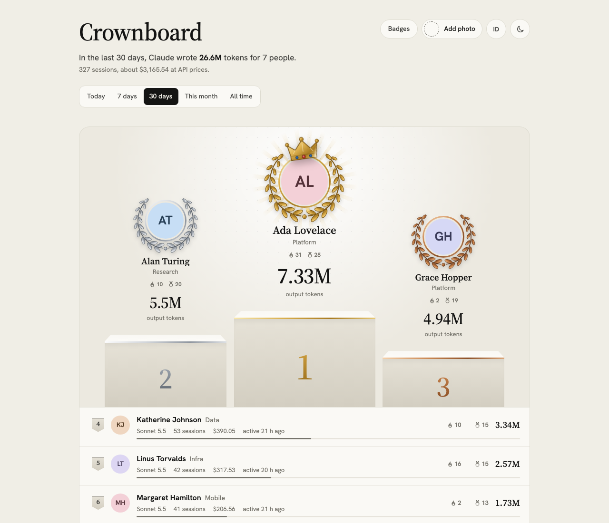
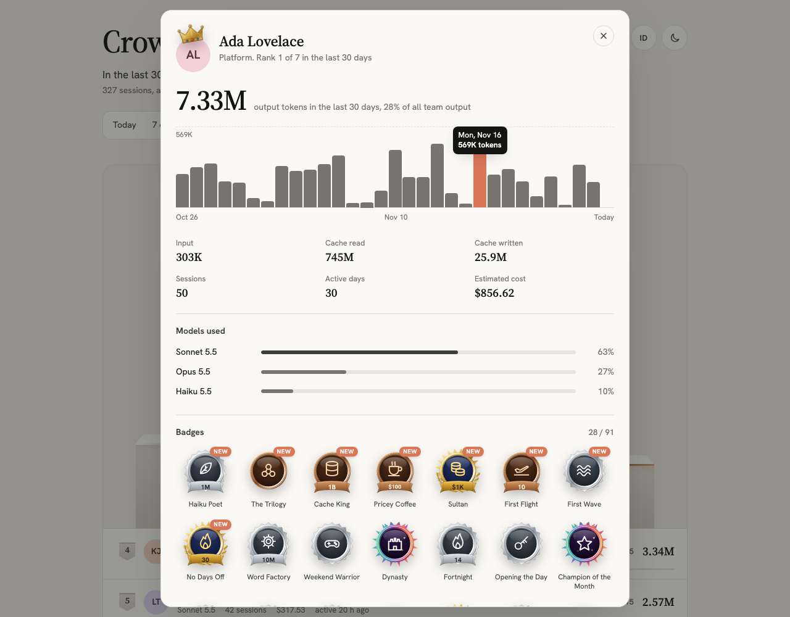
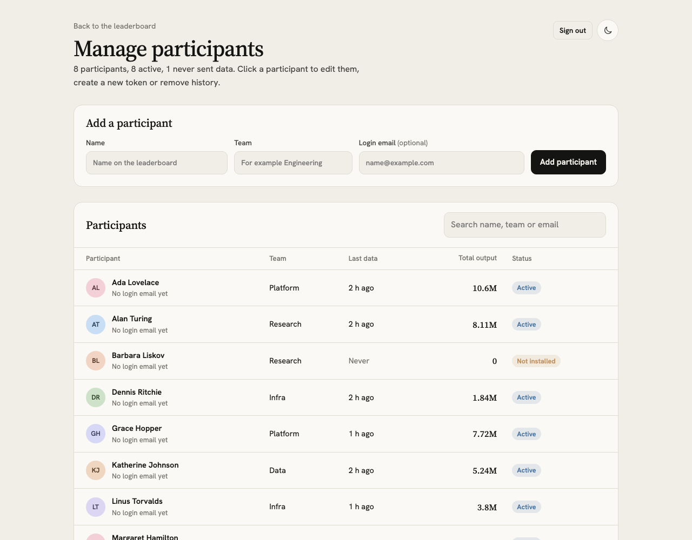

# Claude Code Leaderboard

**Website:** https://leaderboard.kurows.com

A small, self-hosted leaderboard of who writes the most with [Claude Code](https://docs.claude.com/en/docs/claude-code/overview) on your team. Each person's Claude Code reports its own token usage through OpenTelemetry. This works when everyone uses their **own personal account**: you need no shared organization and no admin API key.



- **Podium and live ranking.** Output tokens per person for today, 7 days, 30 days, this month or all time. The page refreshes every second.
- **Detail card per person.** Click anyone to see output over time, models used, cache reads and writes, sessions, active days and estimated API cost.
- **30 days of history on day one.** The installer also reads the local Claude Code transcripts, so the board isn't empty the day you start.
- **9router users too.** People who use [9router](https://github.com/decolua/9router) on a Linux machine join with the same token. Their usage is read from 9router's own log every minute and marked with a "9router" label, and the board can be filtered to Claude Code or 9router users.
- **Admin page.** Add people and copy a ready-made install message for each. You can also rename people, rotate tokens, remove one computer's history or a photo, and delete people.
- **Profile photos.** Each person uploads their own, with a crop and zoom step.
- **Light and dark themes.** English and Bahasa Indonesia interface.
- **Small and simple to run.** One Python file on the standard library, with SQLite storage and no build step. It runs on Linux, macOS or Docker.

| | |
|---|---|
|  |  |

> Not affiliated with Anthropic. "Claude" is a trademark of Anthropic.

## How it works

```
laptop: Claude Code ──OTLP/HTTP JSON (metrics, every 5 s)──▶ server.py ──▶ SQLite
           │                                                  ▲
           └─ installer: reads ~/.claude/projects/*.jsonl ────┘ (hourly totals of the last 30 days)
```

Claude Code has built-in [OpenTelemetry metrics](https://docs.claude.com/en/docs/claude-code/monitoring-usage). The installer adds a few `env` keys to `~/.claude/settings.json` so the metrics go to your server, tagged with a personal token. It backs up the file first. The server keeps hourly totals per person: tokens by type and model, cost, sessions and active time.

**What is sent:** numbers only (token counts, model names, estimated cost, session counts, active time). Prompts, code and file names never leave the laptop. History import sends hourly totals too, never message content.

## Quick start

You need Python 3.10 or newer. There is nothing to `pip install`.

```bash
git clone https://github.com/imkurow/claude-code-leaderboard.git
cd claude-code-leaderboard
cp config.env.example config.env
# set LB_ADMIN_KEY in config.env to a long random string, e.g.  openssl rand -hex 24
python3 server.py
```

1. Open http://127.0.0.1:8790 to see the board.
2. Open http://127.0.0.1:8790/admin, enter your admin key and add a participant.
3. Copy the install command it shows and send it to that person in a **private** chat. They run it once in a terminal and restart Claude Code.

To see it with made-up data first, run `python3 manage.py demo` on an empty database.

### Docker

```bash
cp config.env.example config.env     # set LB_ADMIN_KEY
docker compose up -d                 # http://127.0.0.1:8790
docker compose exec leaderboard python3 manage.py demo   # optional sample data
```

Data lives in the `leaderboard-data` volume.

### Making it reachable for your team

The laptops need to reach the server, and you probably don't want the board on the open internet. Pick one option:

- **Cloudflare Tunnel + Access (recommended).** No open ports and no VPN, and people log in with their work email. Step-by-step: [docs/cloudflare.md](docs/cloudflare.md).
- **Your own reverse proxy with HTTPS** (nginx, Caddy, Traefik). Set `LB_HOST=127.0.0.1`, put the proxy in front, and set `LB_PUBLIC_URL` and `LB_VIEW_KEY`. Viewers then open `https://your-host/?key=<LB_VIEW_KEY>` once.
- **Internal network or VPN only.** Set `LB_HOST=0.0.0.0` and share `http://<server-ip>:8790`. Tokens then travel unencrypted, so only do this on a network you trust.

To keep it running: use `deploy/claude-leaderboard.service` (systemd), Docker's restart policy, or `run.sh` from cron when you have no root. `run.sh` uses `flock`, so it restarts the server within a minute.

## Joining (participants)

The admin page gives each person a command like:

```bash
# macOS / Linux
curl -fsSL https://leaderboard.example.com/install.sh | bash -s -- lb_xxxxxxxx
# Windows (PowerShell)
$env:LB_TOKEN='lb_xxxxxxxx'; irm https://leaderboard.example.com/install.ps1 | iex
```

The installer:

1. Checks the token.
2. Backs up `~/.claude/settings.json` and adds the telemetry settings.
3. Uploads hourly totals from local transcripts made before the install. Re-running it replaces that history, so it never counts twice.

Running it again with `--uninstall` (bash) or `$env:LB_UNINSTALL='1'` (PowerShell) removes the settings. Everyone can see the instructions at `/join`.

To add a photo, a person clicks "Add photo" on the board and pastes their token once.

### People who use 9router

9router keeps its own usage log, so for its users the leaderboard reads that log instead of Claude Code's telemetry. Run the same command with `--9router` on the Linux machine where 9router runs, as the user that runs it:

```bash
curl -fsSL https://leaderboard.example.com/install.sh | bash -s -- lb_xxxxxxxx --9router
```

- **What it installs.** A small Python script in `~/.local/share/claude-leaderboard/` and a cron entry that runs it every minute. It needs `python3` and `crontab`, and changes nothing in 9router.
- **What it sends.** It reads `~/.9router/db/data.sqlite` read-only and sends hourly totals per model: input, output and cache tokens, 9router's cost estimate and the request count. Prompts and responses are never read. The first run sends up to 90 days of history.
- **Every model counts.** 9router can route to Claude, GPT, Gemini, Qwen and others, and all of them count toward the person's total. The detail card shows the split per model.
- **On the board** these people get a "9router" label and a request count instead of sessions. A filter (Everyone, Claude Code, 9router) appears once someone sends 9router data, and ranks follow the filter.
- **Options.** If the database is somewhere else, put `LB_9R_DB=/path/to/data.sqlite` before `bash`. If several people share one 9router, put `LB_9R_KEYS=name1,name2` (9router API key names) before `bash` so each person only sends their own keys.
- **Removing it.** Run the command with `--uninstall --9router`. Usage already on the board stays.
- **Counting twice.** If the same requests also go through Claude Code with telemetry installed, they count twice. Use one or the other for that person.

## Configuration

All settings live in `config.env`, and environment variables override it. See [config.env.example](config.env.example).

| Key | Default | What it does |
|---|---|---|
| `LB_HOST` / `LB_PORT` | `127.0.0.1` / `8790` | Where the server listens |
| `LB_TZ` | `UTC` | Time zone for "today", "this month" and the charts |
| `LB_LANG` | `en` | Interface language: `en` or `id` |
| `LB_TITLE` | `Claude Code Leaderboard` | Page title |
| `LB_PUBLIC_URL` | from request | Base URL used in install commands |
| `LB_ADMIN_KEY` | – | Passphrase for `/admin` |
| `LB_ADMIN_EMAILS` | – | With Cloudflare Access: emails that get `/admin` without the passphrase |
| `LB_VIEW_KEY` | – | Secret link for viewers when you don't use Access |
| `LB_CF_TEAM_DOMAIN`, `LB_CF_VIEWER_AUD` | – | Cloudflare Access login for viewers |
| `LB_CF_CLIENT_ID`, `LB_CF_CLIENT_SECRET` | – | Access service token, put into install commands |
| `LB_DB` | `data/leaderboard.db` | SQLite file |

## Command line

`manage.py` does the same things as the admin page:

```bash
python3 manage.py add "Ada Lovelace" --team Platform   # prints the install commands
python3 manage.py list
python3 manage.py rotate "Ada Lovelace"
python3 manage.py revoke "Ada Lovelace"                 # hide and reject the token; 'activate' undoes it
python3 manage.py rename "Ada Lovelace" "Ada"
python3 manage.py team "Ada" Research
python3 manage.py email "Ada" ada@example.com           # link a login email (Cloudflare Access)
python3 manage.py delete "Ada" --yes
python3 manage.py demo
```

## Security notes

- **Tokens.** Each participant has their own `lb_` token. Only its SHA-256 hash is stored. A token can only send usage for that one person.
- **Admin actions** need either an email in `LB_ADMIN_EMAILS` (verified through Access) or the admin key. Admin sessions are signed `HttpOnly`, `SameSite=Strict` cookies. Every action is logged with who did it.
- **Every write from the browser** needs a custom header and a same-origin `Origin`.
- **Photos** are checked by their file bytes, capped at 600 KB, and served with a sandbox CSP.
- **Without Cloudflare Access**, a participant links their browser by pasting their token. The server answers with a signed cookie; the signing key is created in `data/secret.key` on first start.
- **Use HTTPS** for anything beyond a trusted network, because the token travels in the telemetry headers.

Please report security issues privately via GitHub's "Report a vulnerability".

## Limitations

- **Claude Code or 9router only.** Usage on claude.ai or in the desktop chat doesn't produce these metrics.
- **9router's database layout.** The 9router sync reads 9router's internal `usageHistory` table (tested with 9router 0.5.69). A future 9router version could change it; the sync then stops with a clear message instead of sending wrong numbers.
- **Self-reported numbers.** Someone could send fake numbers with their own token. This is a friendly leaderboard, not billing.
- **Estimated cost.** The cost figure is Claude Code's own estimate at API prices. People on a subscription pay their plan instead.
- **Partial history.** The imported history has tokens but no cost or active time.
- **Windows installer.** It is tested less than the macOS and Linux one. Bug reports are welcome.

## Contributing

Issues and pull requests are welcome. See [CONTRIBUTING.md](CONTRIBUTING.md) for how to run it locally and the few ground rules.

## Authors

Built by [imkurow](https://github.com/imkurow) together with Claude (Anthropic) in Claude Code.

## License

[MIT](LICENSE)
